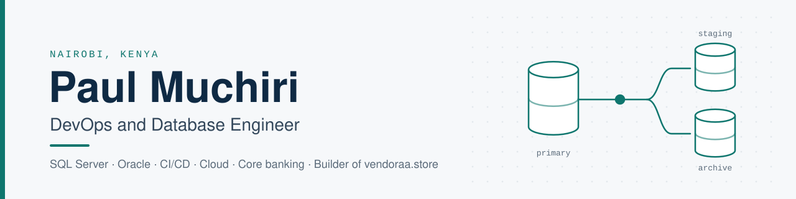
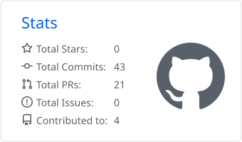
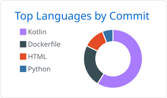

<picture>
  <source media="(prefers-color-scheme: dark)" srcset="assets/banner-dark.svg">
  
</picture>

  
  
  
  
  

## About

I run production support for the PROFITS core banking system at Relational FS, across more than six banks and SACCOs in Africa and Europe. Most days that means SQL Server and Oracle, Windows and Linux servers, and the network between them, taking incidents from first report to root cause.

I also build the tools my team relies on, and outside work I co-founded and built [vendoraa.store](https://vendoraa.store), a marketplace that gives small Kenyan businesses their own online shop with M-Pesa payments.

- **Now:** Senior Technical Support Engineer at Relational FS, and Co-founder and Lead Engineer at Vendora
- **Good at:** SQL Server performance, blocking and deadlocks, partitioning and archiving, Oracle AWR, CI/CD, Linux and Windows servers
- **Learning:** AWS, GCP and SRE practices
- **Off the keyboard:** Arsenal for life

## Featured work

<table>
<tr>
<td width="50%" valign="top">

**[Vendora](https://vendoraa.store)** &nbsp;live

Marketplace where small businesses rent their own online shop and buyers pay the seller's M-Pesa directly. Subscriptions with a free tier, M-Pesa payment matching, WhatsApp and SMS order alerts, campaigns and seller analytics. Nightly off-site backups and uptime checks.

`FastAPI` `Jinja2` `SQLite` `pytest` `GitHub Actions` `Render` `Cloudflare`

</td>
<td width="50%" valign="top">

**DBOps (Archivio)** &nbsp;internal

Automates SQL Server archiving for PROFITS core banking: partition switching through staging and archive databases, row-count validation and reports, plus a database operations workspace. Cut manual archiving work by about 80%.

`Python` `FastAPI` `SQL Server` `Nuitka` `Inno Setup`

</td>
</tr>
<tr>
<td width="50%" valign="top">

**IT Operations platform** &nbsp;internal

An API performance lab for load and stress testing core banking APIs, an automated deployment module, and an assistant that drafts tender responses from approved reference material.

`Python` `FastAPI` `Ansible` `WinRM` `SFTP`

</td>
<td width="50%" valign="top">

**[Memorial website](https://joviellemuigai.com)** &nbsp;live

Family memorial site with a private family area, timeline, family tree, gallery, videos and tributes. Photo uploads are resized with location data stripped, and a Claude API chat feature runs within usage limits.

`FastAPI` `SQLite` `Docker` `Render` `Claude API`

</td>
</tr>
<tr>
<td width="50%" valign="top">

**LearnHub** &nbsp;internal

The company's training and onboarding platform, with courses, assessments, assignments and completion certificates.

`FastAPI` `MySQL` `Docker` `nginx`

</td>
<td width="50%" valign="top">

**[Server Health Check](https://github.com/pmc-muchiri/ServerHealthCheck)**

Desktop dashboard that inspects a local or remote Windows server through PowerShell and CIM.

`Python` `PySide6` `PowerShell`

</td>
</tr>
</table>

**More on GitHub:** [Terraform and Ansible workshop](https://github.com/pmc-muchiri/iac-w-ansible-terraform) · [Node.js e-commerce API](https://github.com/pmc-muchiri/yolo) · [Airbnb e-wallet (PHP, MySQL)](https://github.com/pmc-muchiri/Vizzie-AirBNB-Ewallet) · [Moringa DevOps coursework](https://github.com/pmc-muchiri/Devops-MoringaSchool) · Sacco Dashboard (private: FastAPI, React, PostgreSQL, Docker)

## Tech stack

<table>
<tr>
<td><b>Databases</b></td>
<td>

</td>
</tr>
<tr>
<td><b>DevOps and CI/CD</b></td>
<td>

</td>
</tr>
<tr>
<td><b>Cloud and servers</b></td>
<td>

</td>
</tr>
<tr>
<td><b>Languages and frameworks</b></td>
<td>

</td>
</tr>
</table>

Also: Zabbix, Hyper-V, Vagrant, IIS, FortiGate, Query Store, sp_BlitzLock, WinRM, Nuitka and Inno Setup.

## Experience

| Role | Where | When |
|---|---|---|
| Co-founder and Lead Engineer | Vendora Digital StoreFront | Oct 2026 to now |
| Senior Technical Support Engineer | Relational FS | Dec 2025 to now |
| Technical Support Engineer | Relational FS | Jul 2024 to Nov 2025 |
| Junior DevOps Engineer | Copia Global | Jan 2022 to Jul 2024 |
| System Administrator | Copia Global | Jun 2021 to Jan 2022 |
| Technical Support Specialist | Copia Global | Mar 2020 to Jun 2021 |

A few things I'm proud of:

- Traced a SACCO's channel outage, with USSD and internet banking failing at about 70%, to an idle session holding an uncommitted lock. Found the head blocker live on the call.
- Captured 1,013 deadlocks in a single day across 470+ gateway worker processes and packaged the evidence for the vendor as a product defect.
- Built DBOps, which cut manual SQL Server archiving work by about 80%.
- At Copia, built Jenkins and Bitbucket pipelines with Docker and Kubernetes that cut deployment time by about 60%.

## Education

- **BSc Mathematics and Computer Science**, Jomo Kenyatta University of Agriculture and Technology (2013 to 2018)
- **DevOps Engineering Programme**, Moringa School (2025)

## GitHub activity

  <picture>
    <source media="(prefers-color-scheme: dark)" srcset="profile-summary-card-output/github_dark/3-stats.svg">
    
  </picture>
  <picture>
    <source media="(prefers-color-scheme: dark)" srcset="profile-summary-card-output/github_dark/2-most-commit-language.svg">
    
  </picture>

  <picture>
    <source media="(prefers-color-scheme: dark)" srcset="https://github-readme-streak-stats.herokuapp.com/?user=pmc-muchiri&hide_border=true&background=0D1117&ring=2DD4BF&fire=2DD4BF&currStreakLabel=2DD4BF&currStreakNum=E6EDF3&sideNums=E6EDF3&sideLabels=8B949E&dates=8B949E&stroke=30363D">
    
  </picture>

Most of my work lives in private repositories, so these numbers only show part of it.

  

